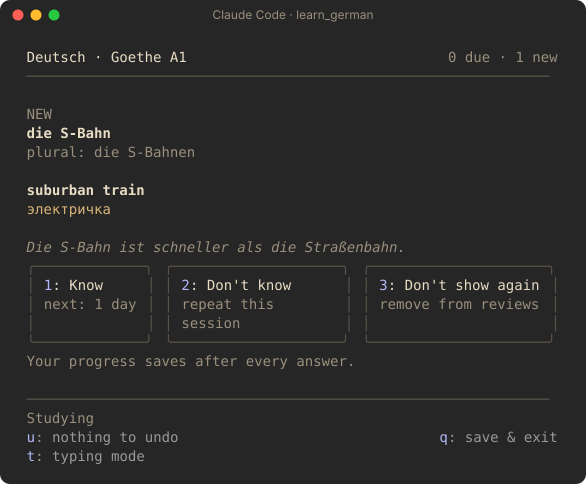

# andrew-marketplace

A [Claude Code](https://claude.com/claude-code) plugin marketplace: plugins that change how Claude Code looks and works.

## Plugins

| Plugin | Description |
| --- | --- |
| [**learn_german**](plugins/learn_german/README.md) | German vocabulary flashcards (Goethe-Zertifikat A1, A2, B1) in a side pane while Claude works. Spaced repetition, flip and typing modes, English and Russian meanings. |

<a href="plugins/learn_german/README.md"></a>

## Install

### 1. Add the marketplace

Do this one time. At the Claude Code prompt in a terminal:

```
/plugin marketplace add AndreiErofeev/andrew-marketplace
```

### 2. Install a plugin

```
/plugin install <plugin>@andrew-marketplace
```

For example: `/plugin install learn_german@andrew-marketplace`. Then select a scope. The plugin starts immediately.

You can also do both steps with one command:

```
/plugin install learn_german --marketplace AndreiErofeev/andrew-marketplace
```

### From a shell

```
claude plugin marketplace add AndreiErofeev/andrew-marketplace
claude plugin install learn_german@andrew-marketplace
```

### In the desktop app

Click **+** next to the prompt box, then **Plugins**. Select **Add marketplace** and type `AndreiErofeev/andrew-marketplace`. Then select **Add plugin**.

## Update

To get new versions of the plugins:

```
/plugin marketplace update andrew-marketplace
```

## Remove

```
/plugin uninstall learn_german@andrew-marketplace
/plugin marketplace remove andrew-marketplace
```

## Repository layout

```
.claude-plugin/marketplace.json   the list of plugins in this marketplace
plugins/<plugin>/                 one folder for each plugin, with its own README
```
