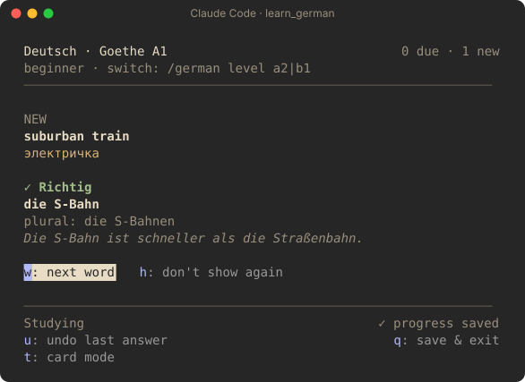

# learn_german

Learn German vocabulary while Claude Code works. When Claude does a long task, a side pane opens with flashcards. When Claude finishes, the pane shows your results and closes.

- Word lists: Goethe-Zertifikat A1 (687 words), A2 (1172 words) and B1 (2825 words).
- Each card shows the word with its article, plural or verb forms, the English and Russian meaning, and example sentences.
- Spaced repetition (Leitner boxes): words you know come back after longer intervals, and words you miss come back in the same session.
- Two modes: flip cards, and typing (you type the German word, with its article).
- Progress is saved after each answer.

<p>
  
  
</p>

## Install

At the Claude Code prompt in a terminal:

```
/plugin marketplace add AndreiErofeev/andrew-marketplace
/plugin install learn_german@andrew-marketplace
```

Then select a scope. For other ways to install (one command, shell, desktop app), see the [marketplace README](../../README.md#install).

## First start

You do not have to set anything. The plugin starts with the A1 list and flip-card mode. The top of the pane shows the current list and the command to change it, for example `/german level a2|b1`.

Type `/german` to open the pane now, or wait until Claude works on a long task.

If the pane opens by itself during Claude's work and does not have focus, press `ctrl+x` then `tab` to focus it. Press `Esc` to go back to the prompt.

## Commands

| Command | What it does |
| --- | --- |
| `/german` | Open or close the pane. |
| `/german level a1\|a2\|b1` | Select the word list (default: A1). Your progress for each word stays. |
| `/german flip` / `/german type` | Select flip-card mode or typing mode. |
| `/german stats` | Show the counts for the current list: learning, mastered, hidden, not seen. |
| `/german on` / `/german off` | Turn the automatic pane on or off. |
| `/german reset` | Delete your progress for all lists. To prevent accidents, this only asks: to delete, type `/german reset confirm` within 60 seconds. Settings stay. |
| `/german set seconds <n>` | Seconds of work before the pane opens (default 20). |
| `/german set tools <n>` | Number of tool calls that count as work when Claude only reads (default 3). |
| `/german set reopen <n>` | When a new task starts within this many seconds after the pane closed, the pane opens again immediately (default 10). |
| `/german set stats <n>` | Seconds the results stay before the pane closes (default 3). |
| `/german help` | Show the current settings. |

## Keys in the pane

| Key | Flip mode | Typing mode |
| --- | --- | --- |
| `s` | Show the meaning | Show the answer (counts as "don't know") |
| `1` | I know it | — |
| `2` | I don't know it | — |
| `3` | Don't show this word again | Don't show this word again |
| `Enter` | — | Check your answer |
| `n` | — | Next word |
| `u` | Undo the last answer | Undo the last answer |
| `t` | Change to typing mode | Change to flip mode |
| `q` | Save and close for this task | Save and close for this task |

## When the pane opens

The pane opens when Claude works for 20 seconds or more and does real work: it edits a file, runs a command, or starts an agent, or it makes 3 or more tool calls. The pane closes when Claude asks you a question or needs a permission, and opens again after you answer.

## Review intervals

A word you know moves to the next box. The wait for each box is: 10 minutes, 1 day, 3 days, 7 days, 14 days, 30 days. A word you miss goes back to the first box and comes back after 5 other cards. To change the intervals, edit `INTERVALS` in [hooks/srs.ts](hooks/srs.ts).

## Word lists

The word lists come from the Goethe-Institut Wortlisten for Goethe-Zertifikat A1 (Start Deutsch 1), A2 and B1. The Goethe-Institut owns the copyright of these lists. The English and Russian meanings were added for this plugin.

## Development

- `hooks/register.tsx`: the pane, the `/german` command, settings and the open and close rules.
- `hooks/srs.ts`: intervals, grading, the next-card rule and the answer check.
- `hooks/words.ts`: the words. `hooks/levels.ts`: the word ids in each list.
- Tests: `claude plugin test plugins/learn_german`. Type check: `tsc -p plugins/learn_german`.
